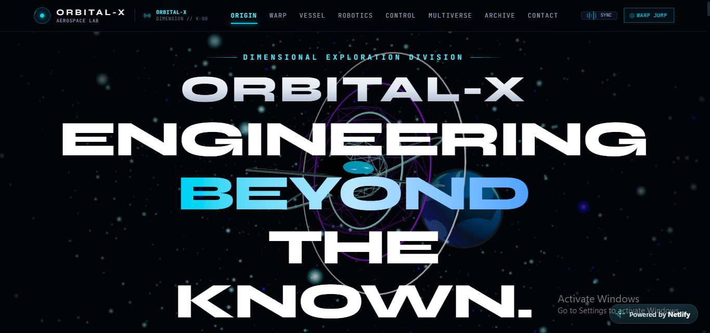
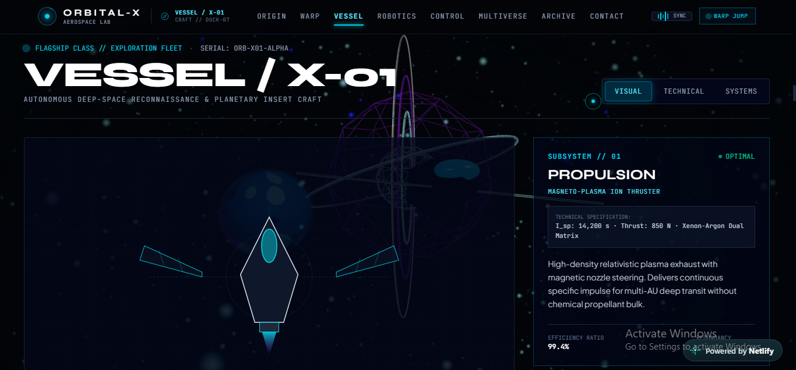
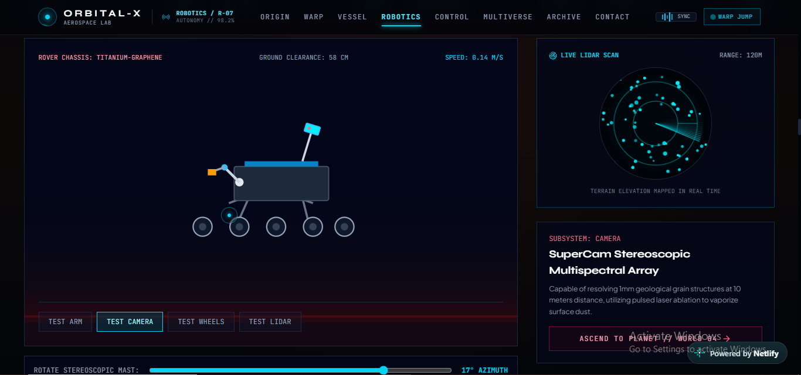
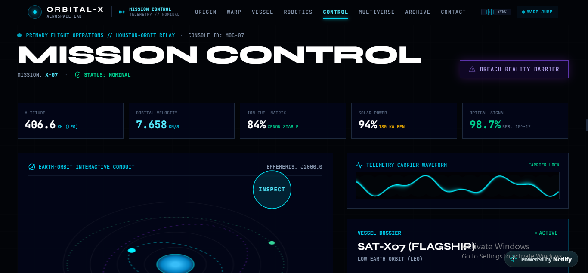
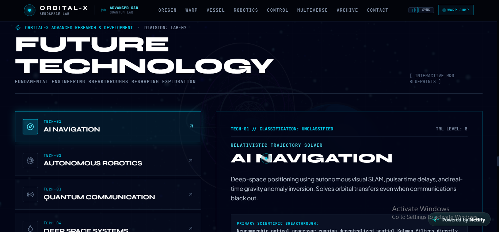
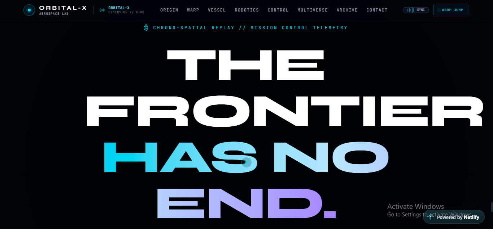
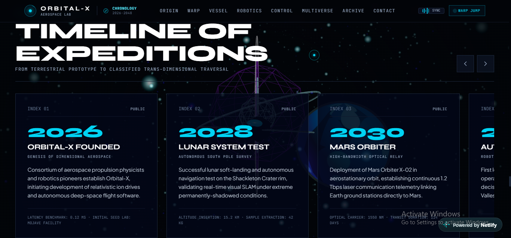
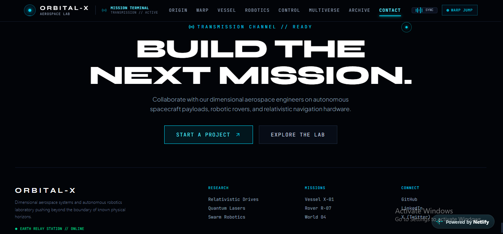

# ORBITAL-X

> ENGINEERING BEYOND THE KNOWN

A cinematic, experimental aerospace and robotics web application combining NASA-inspired engineering, autonomous planetary exploration, mission control telemetry, and relativistic spacetime warp visualization.

## Key Features

- **Warp Calibration HUD:** Terminal initialization sequence with system diagnostic progress bars.
- **Persistent WebGL 3D Canvas:** Procedural star warp fields, rotating dimensional portal rings, ion engine plume effects, and interactive planetary bodies built with Three.js.
- **Transforming Aerospace Navigation:** Dynamic HUD navigation that adapts its coordinates and telemetry tags as users travel through different sectors.
- **Vessel X-01 Flagship:** Interactive 3D spacecraft featuring five engineering hotspots: Propulsion, Navigation, Laser Communications, Photovoltaic Sails, and AI Core, alongside a technical blueprint view.
- **Robotics / R-07 Mars Surface:** Extreme-environment rover featuring autonomy telemetry, a six-axis sampling arm, a rotating stereoscopic mast, and a canvas-based LiDAR radar sweep.
- **World / 04 Survey:** Fictional terrestrial exoplanet with an interactive globe and selectable landing zones, including Meridiani Chasm, Valles Olympus, and Prometheus Crater.
- **Mission Control Flight Console:** Telemetry for altitude, velocity, ion fuel, and optical signals, with a carrier oscilloscope and Earth-orbit satellite tracker.
- **Dimensional Rupture Event:** Spacetime distortion sequence featuring tensor divergence, singularity collapse, and a warp transition into unmapped reality.
- **The Unknown and Multiverse Passage:** Monolithic megastructure observation and a five-sector reality switcher.
- **Future R&D Lab and Chronology:** Experimental engineering concepts and a horizontally scrollable timeline spanning 2026 to 2048.
- **Mission Archive and Terminal CTA:** Interactive mission dossiers and a project inquiry form.

## Screenshots

### Main Experience



### Vessel X-01



### R-07 Mars Rover



### Mission Control



### Future Technology



### The Unknown



### Mission Timeline



### Collaboration and Project Lab



## Tech Stack

| Technology | Purpose |
|---|---|
| React 19 | User interface |
| TypeScript | Type-safe development |
| Tailwind CSS | Styling and responsive layouts |
| Three.js | Interactive 3D graphics and WebGL rendering |
| Motion | Animations and transitions |
| Lucide React | Interface icons |
| Vite | Development server and build tooling |

## Quick Start

### 1. Clone the Repository

```bash
git clone https://github.com/MahamYasir-ai/orbital-x.git
cd orbital-x
```

### 2. Install Dependencies

```bash
npm install
```

### 3. Start the Development Server

```bash
npm run dev
```

Open the local URL displayed in your terminal to view the application.

### 4. Build for Production

```bash
npm run build
```

## Live Demo

[Explore ORBITAL-X](https://orbitalx-robo.netlify.app/)

## Repository

[GitHub — MahamYasir-ai/orbital-x](https://github.com/MahamYasir-ai/orbital-x)

## License

Apache-2.0 — Developed for ORBITAL-X.
